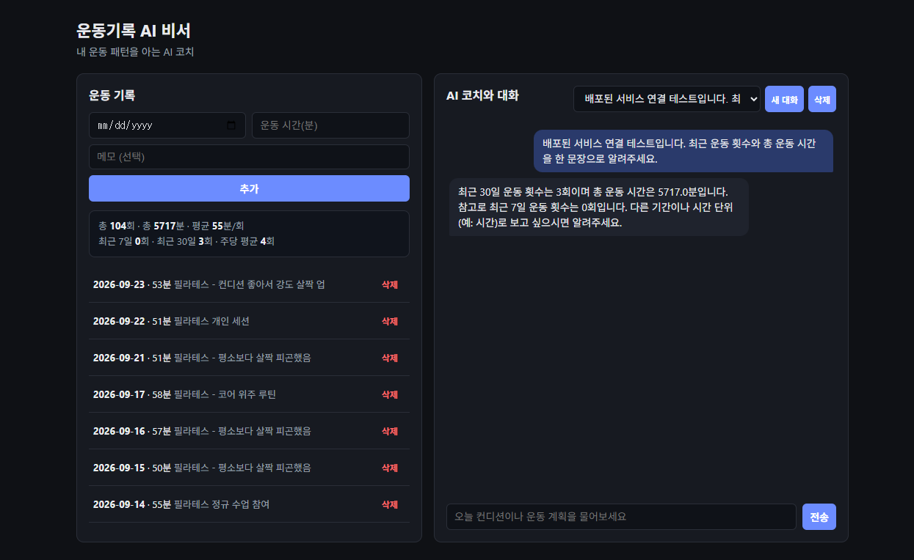
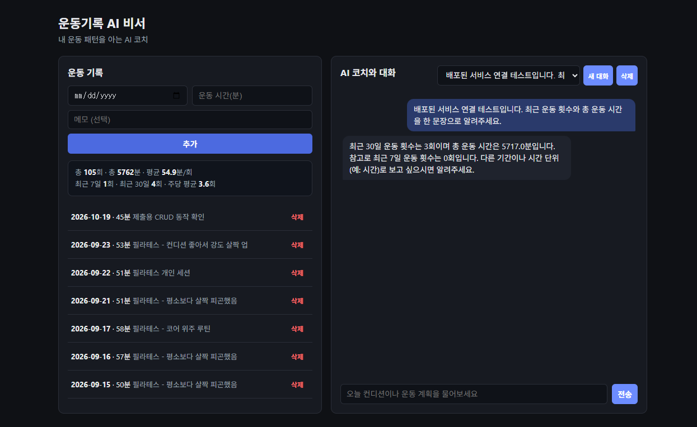
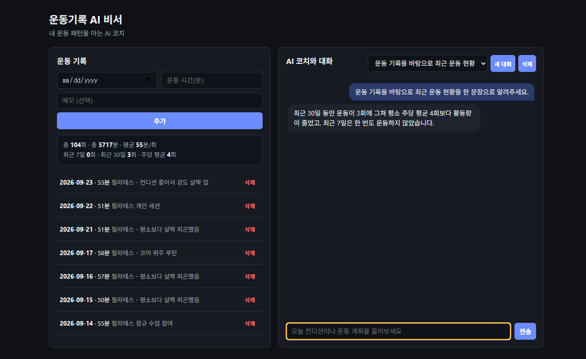

# 운동기록 AI 비서

개인 운동기록(시계열) 데이터를 분석해 GPT 챗봇에 요약을 주입하는 풀스택 미션.

## 구조
```
backend/    FastAPI + Firestore + OpenAI
frontend/   바닐라 HTML/CSS/JS
```

## 1. 데이터 생성
최근 6개월 동안 평일 중 주 4일, 회당 50~60분 필라테스 패턴으로 시계열 데이터(104건)를 생성했습니다.

```bash
cd backend
python3 generate_data.py   # workout_seed_data.json 생성
```

## 2. 백엔드 로컬 실행
```bash
cd backend
pip install -r requirements.txt
cp .env.example .env   # 값 채우기 (Firestore 서비스 계정 키, API 키와 Base URL)
python3 seed_firestore.py   # 생성한 시드 데이터를 Firestore에 업로드
uvicorn app.main:app --reload --env-file .env
```
- API 문서: http://localhost:8000/docs
- OpenAI API를 직접 사용할 때는 `OPENAI_BASE_URL`을 비워 두고, Codyssey 공개 API를 사용할 때는 Codyssey API 콘솔 문서 탭의 Base URL과 `/v1/models`에서 확인한 지원 모델명을 `.env`에 설정합니다.

### 엔드포인트
| Method | Path | 설명 |
|---|---|---|
| POST | /api/data | 기록 추가 |
| GET | /api/data | 기록 목록 |
| PUT | /api/data/{id} | 기록 수정 |
| DELETE | /api/data/{id} | 기록 삭제 |
| GET | /api/data/summary | 통계 요약 (GPT 프롬프트에 주입됨) |
| POST | /api/conversations | 대화 생성 |
| GET | /api/conversations | 대화 목록 |
| GET | /api/conversations/{id} | 대화 상세 |
| DELETE | /api/conversations/{id} | 대화 삭제 |
| POST | /api/chat | 메시지 전송 → summary 주입 → GPT 응답 → 자동 저장 |

## 3. 로컬 통합 테스트 (실제 Firestore/OpenAI 없이 검증)
Firestore를 흉내낸 in-memory fake와 mock된 GPT 응답으로 전체 API 흐름
(기록 CRUD → summary 계산 → 대화 생성/저장 → 히스토리 자르기)을 검증합니다.
실제 클라우드 자격 증명이 없어도 실행 가능합니다.
```bash
cd backend
pip install -r requirements.txt -r requirements-dev.txt
pytest tests/test_api_integration.py -v
```

## 4. 프론트엔드 로컬 실행
`frontend/config.js`의 `API_BASE_URL`을 백엔드 주소로 맞춘 뒤 `index.html`을 브라우저로 열거나 정적 서버로 서빙하면 됩니다.
```bash
cd frontend
python3 -m http.server 5500
```

## 5. 배포
- GitHub 저장소의 `render.yaml`을 Render Blueprint로 배포합니다. `GOOGLE_APPLICATION_CREDENTIALS_JSON`에는 Firebase 서비스 계정 JSON 전체를 비밀 환경변수로 입력하고, `OPENAI_API_KEY`에는 Codyssey 공개 API 키를 입력합니다.
- Render 배포 후 `https://<render-service>.onrender.com` 형태의 백엔드 URL을 확인하고 `/docs`에서 Swagger UI를 검증합니다.
- Vercel에서 GitHub 저장소를 가져오고 Root Directory를 `frontend`로 지정해 정적 사이트로 배포합니다. 현재 `frontend/config.js`의 API URL은 Render 백엔드 주소를 사용합니다.
- Render Blueprint의 `ALLOWED_ORIGINS`는 배포된 Vercel 도메인만 허용하도록 설정합니다.

### 배포 주소
- 프론트엔드: https://leejuran-workout-ai-assistant-front.vercel.app
- 백엔드 API: https://workout-ai-assistant-api-qyuq.onrender.com
- Swagger UI: https://workout-ai-assistant-api-qyuq.onrender.com/docs

Render 무료 인스턴스는 비활성 상태 후 슬립될 수 있어 첫 요청에 지연이 발생할 수 있습니다.

## 제출 스크린샷

### 데이터 요약이 반영된 AI 채팅


### 운동 기록 추가 (CRUD)


캡처 후 제출 확인용 임시 기록은 삭제해 Firestore의 기존 데이터 상태로 복원했습니다.

### 저장된 대화 불러오기


## 남은 TODO
- Firestore 보안 규칙 설정 (현재 서버 SDK만 접근한다고 가정)
- (선택) 대화 목록에 검색/페이지네이션 추가
